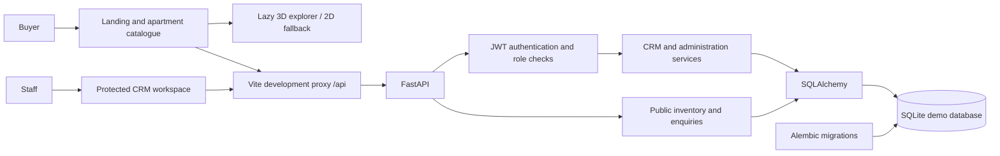
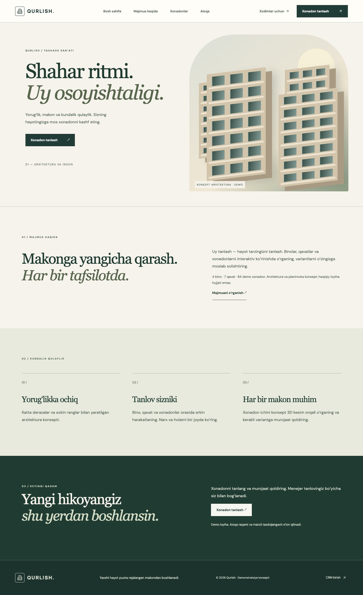
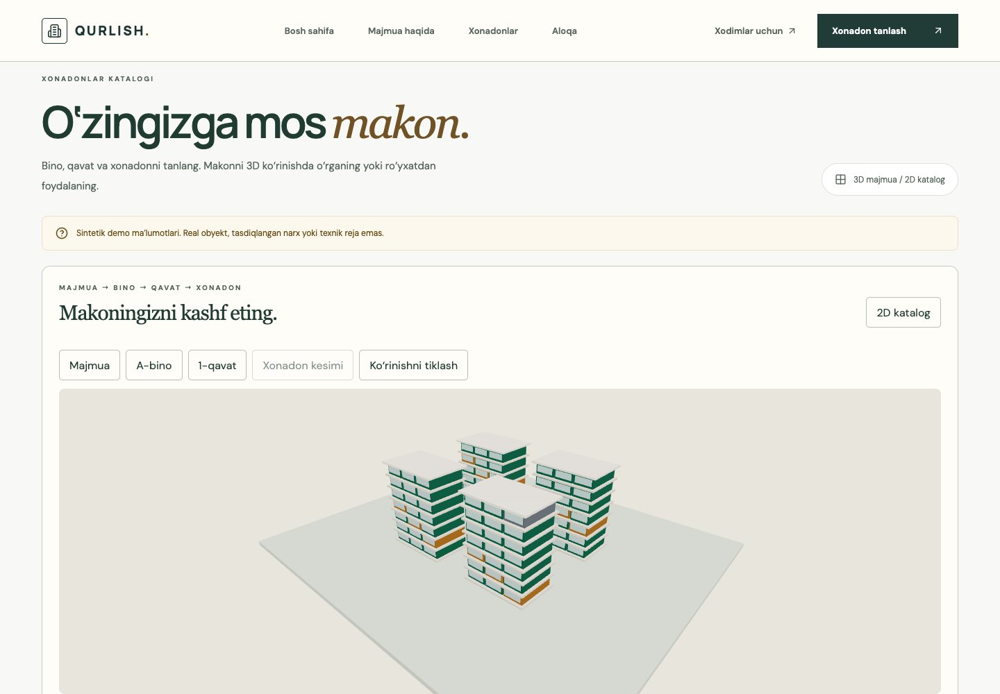
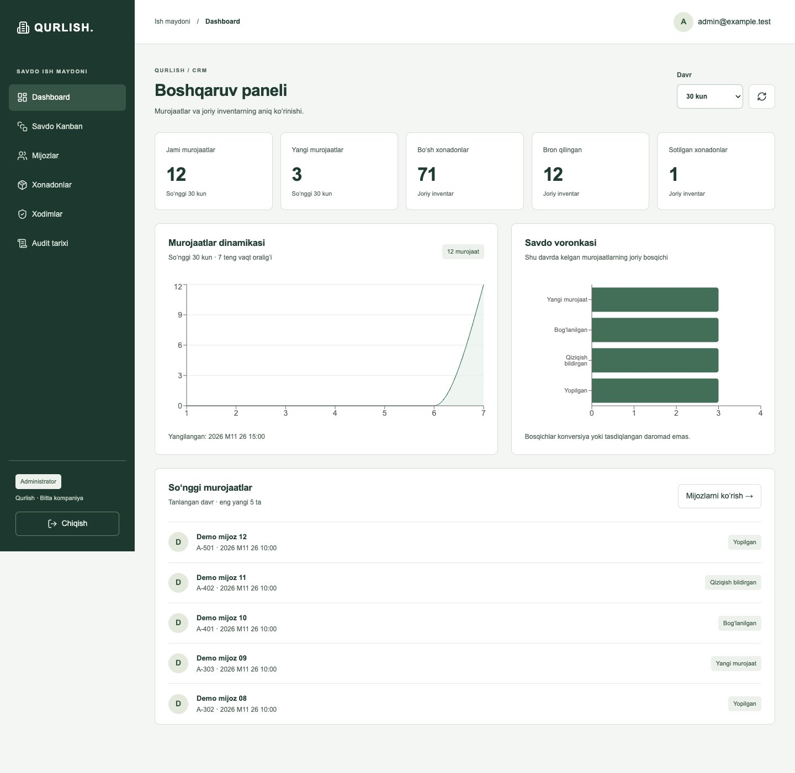
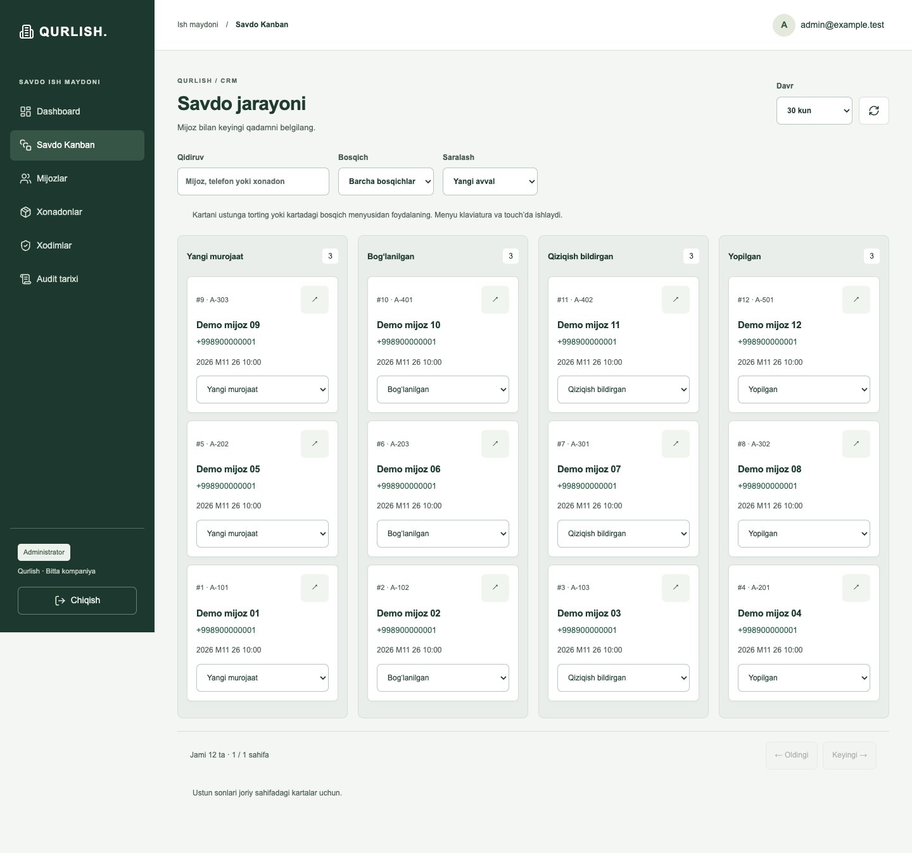
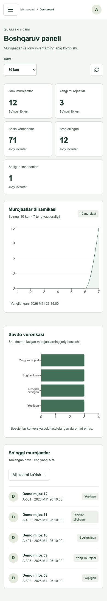

# Qurlish CRM · Portfolio Release v1.0

A construction sales CRM with a public apartment catalogue, an interactive 3D explorer, and a protected staff workspace. Built with React, TypeScript, and FastAPI; the documented local demo uses SQLite.

## Project Overview

Qurlish connects the buyer journey—exploring a residential complex, choosing an apartment, and submitting an enquiry—with the staff workflow for following up on leads. The interface is in Uzbek. This release packages the existing v0.6 functionality for portfolio review without expanding its product scope.

This is a single-company demonstration project, **not a production-ready real estate platform**. Apartments, prices, and 3D geometry in the demo are illustrative. No database, administrator credentials, or runtime secrets are included in the repository.

## Key Features

- Responsive public landing page and apartment catalogue.
- Interactive building, floor, and apartment selection, with an optional 3D view and a usable 2D fallback.
- Public enquiry form with server-side availability checks and idempotent submission.
- Staff dashboard with 7/30/90-day lead totals, activity charts, current pipeline stages, and inventory counts.
- Four-stage Kanban board: new, contacted, qualified, and closed/lost. Drag-and-drop and select controls persist changes; rejected updates roll back in the interface.
- Searchable, sortable, paginated client list and client details with apartment information, activity history, and internal notes.
- Inventory filtering and administrator-only available/reserved status changes.
- Administrator tools for staff creation, role changes, deactivation, and audit history.
- Admin, Seller, and Viewer access enforced by the backend.

## Technology Stack

| Layer | Technologies used |
|---|---|
| Frontend | React 19, TypeScript 5, Vite 6, CSS, Lucide icons |
| Charts | Recharts 3 |
| 3D | Three.js, React Three Fiber 9, Drei 10 |
| Backend | Python, FastAPI, Pydantic, Uvicorn |
| Persistence | SQLite, SQLAlchemy 2, Alembic |
| Authentication | PyJWT, Argon2 password hashing, rotating refresh tokens |
| Configuration | python-dotenv and process environment variables |
| Verification | pytest, HTTPX/TestClient, Playwright with Chrome, Ruff, TypeScript compiler |

The backend dependencies also include the Psycopg driver for an existing PostgreSQL code path. This release uses SQLite; PostgreSQL integration has not been verified.

## System Architecture



The browser uses relative `/api` requests. In local development, Vite proxies them to FastAPI on port 8000 while preserving the request origin. The CRM and 3D scene load as separate JavaScript chunks. The backend does not create tables or seed accounts on application startup; migrations and demo seeding are explicit commands.

## Database Design

| Table | Purpose and relationships |
|---|---|
| `companies` | Company identity; the application is configured for one company |
| `users` | Staff email, password hash, role, active flag, and company |
| `units` | Apartment building/floor/number, room count, area, integer price, availability, and company |
| `leads` | Buyer contact, selected unit, pipeline stage, creation time, and company |
| `lead_events` | Creation events, stage changes, and internal notes linked to a lead |
| `idempotency` | Submission key and payload hash linked to the resulting lead |
| `refresh_sessions` | Hashed refresh tokens, user, session family, expiry, rotation, and revocation state |
| `audit_logs` | Security and business events with actor, company, resource, and timestamp |

Company filters apply to inventory, leads, users, events, and audit reads. Alembic revision `20261124_v04` creates the current schema and supports the earlier identity migration. A backup is required before applying migrations to an existing database; the fresh-demo instructions below are not a migration guide for live data.

## Authentication & Security

- Passwords are hashed with Argon2. There is no bundled default administrator password.
- Short-lived access JWTs are held in browser memory, not localStorage or sessionStorage. The default lifetime is 15 minutes.
- Refresh tokens use an `HttpOnly`, `SameSite=Strict` cookie scoped to `/api/auth`. Only their SHA-256 hashes are stored in the database. The default session lifetime is 14 days.
- Each refresh rotates the token. Reuse of a consumed token revokes its session family. Logout revokes the session; role changes and account deactivation revoke that user's sessions.
- Protected requests check the current account and session state as well as the JWT. SQLite write serialization coordinates security mutations.
- Web Locks serialize refresh across tabs; BroadcastChannel propagates logout. Automatic refresh requires a secure context such as localhost and Web Locks support.
- State-changing API requests check Origin and Fetch Metadata. Auth, CRM, and admin responses use `Cache-Control: no-store`.

| Capability | Admin | Seller | Viewer |
|---|---|---|---|
| View dashboard, clients, and inventory | Yes | Yes | Yes |
| Change lead stage / add internal notes | Yes | Yes | No |
| Change available/reserved inventory status | Yes | No | No |
| Manage staff / read audit history | Yes | No | No |

`JWT_SECRET` is loaded automatically from the repository-root `.env`, regardless of the Python working directory. Explicit process variables take precedence, including an explicitly empty value. Interpolation is disabled so dollar signs remain literal. Relative database paths are still relative to the process working directory: run the commands below from the repository root, or use an absolute SQLite URL. Keep the same secret across restarts; changing it invalidates existing access JWTs.

## Interactive 3D Apartment Explorer

Open `/apartments`, then select **3D majmuani ochish** to load the scene. Buyers can select a building, isolate a floor, choose an apartment, orbit/zoom/reset the camera, and inspect a conceptual apartment cutaway. HTML controls support keyboard navigation and room selection.

Apartment IDs, availability, areas, and prices come from the API. The geometry is generated locally; no paid 3D service, hosted model, or API key is required. The scene uses demand rendering and reduced-motion handling. Unsupported WebGL or a scene-loading failure leaves the 2D catalogue available.

The cutaway, furnishings, and room dimensions are concepts, not approved architectural plans. The apartment detail's external Unsplash image is illustrative and requires internet access.

## Project Structure

```text
backend/
  main.py                 FastAPI application and route assembly
  config.py               Runtime settings
  environment.py          Repository-root .env loading
  identity.py             SQLAlchemy models and database sessions
  auth.py                 Login, JWT, refresh rotation, logout, RBAC
  inventory.py            Public inventory and enquiry endpoints
  crm_api.py              Leads, details, notes, history, metrics
  crm_service.py          Reporting periods and SQL aggregations
  workspace_api.py        Paginated inventory and audit projections
  catalog_admin.py        Staff and inventory administration
  demo_seed.py             Explicit SQLite demo seed
  bootstrap.py             Alternative one-time administrator bootstrap
  migrations/             Alembic schema migrations
frontend/
  src/main.tsx             Public catalogue, enquiry form, app routing
  src/PremiumLanding.tsx   Public landing page
  src/Explorer.tsx         3D controls and fallback boundary
  src/Scene.tsx            Three.js scene and cutaway
  src/ProfessionalCRM.tsx  Staff workspace
  src/WorkspaceAdmin.tsx   Inventory, staff, and audit views
  src/workspaceShared.tsx  Remote data, dialogs, pagination, UI states
  src/api.ts               API client and browser authentication
  e2e/                     Playwright tests
scripts/                   Local demo and isolated browser-test helpers
tests/                     Backend and migration regression tests
docs/                      Review evidence and screenshots
.env.example               Safe configuration template; no usable secrets
```

The root HTML/JavaScript files are retained legacy demo/staff pages. The current portfolio interface is the React application served by Vite.

## Local Installation & Setup

### Prerequisites

Use Python 3.11 or newer, Node.js 22 or newer with npm, and Git. Google Chrome is required for the current Playwright configuration. The final checks ran on macOS with Python 3.13.0, Node.js 25.3.0, and npm 11.7.0; other platforms were not tested in this review.

The commands below use a POSIX shell (macOS/Linux). On Windows, use the corresponding virtual-environment activation and environment-variable syntax.

### 1. Clone and install dependencies

Until the release PR is merged, clone its existing feature branch:

```bash
git clone --branch feature/v0.6-professional-crm https://github.com/gulinur678-bit/qurlish-crm.git
cd qurlish-crm
python3 -m venv .venv
source .venv/bin/activate
python -m pip install -r backend/requirements-dev.txt
npm --prefix frontend ci
```

`requirements-dev.txt` includes the backend dependencies and Ruff. `backend/requirements.txt` can be used when lint tooling is not needed.

### 2. Configure the local environment

For a new clone, create `.env` without overwriting an existing file:

```bash
test ! -e .env && cp .env.example .env
chmod 600 .env
python -c 'import secrets; print(secrets.token_urlsafe(48))'
```

Paste the generated value into `JWT_SECRET` in `.env`. Leave `DATABASE_URL=sqlite:///./demo-only.db` for this fresh local demo. Do not commit `.env` or reuse its secret in another environment. If `.env` already exists, inspect it instead of replacing it. Previously exported variables override the file; unset unwanted overrides before continuing.

| Variable | Meaning / local setting |
|---|---|
| `DATABASE_URL` | `sqlite:///./demo-only.db`; fresh demo file in the repository root |
| `JWT_SECRET` | Required unique random secret, at least 32 characters; blank in the template |
| `COOKIE_SECURE` | `0` for local HTTP; secure cookies require HTTPS |
| `COMPANY_ID` / `COMPANY_NAME` | Single company identity, default `qurlish` / `Qurlish Construction` |
| `ACCESS_TOKEN_SECONDS` | Access JWT lifetime, default `900` |
| `REFRESH_TOKEN_SECONDS` | Refresh session lifetime, default `1209600` |
| `DEMO_DATABASE_ONLY` | Default `0`; explicitly set `1` only for the seed command |
| `DEMO_ADMIN_EMAIL` | Local demo login email, default `admin@example.test` |
| `DEMO_ADMIN_PASSWORD` | One-time seed password supplied through the process environment |
| `BOOTSTRAP_ADMIN_EMAIL` / `BOOTSTRAP_ADMIN_PASSWORD` | Alternative bootstrap command; not needed for the demo seed |

Restart the backend after changing configuration. The application does not automatically rotate or generate a secret on ordinary Uvicorn startup.

### 3. Create a NEW SQLite demo database

These commands are for an absent `demo-only.db` at the URL above. **Do not run them against an existing customer or demo database.** If the file already exists, skip initialization and start the application using its existing configuration and account.

```bash
test ! -e demo-only.db && python -m alembic upgrade head
export DEMO_DATABASE_ONLY=1
export DEMO_ADMIN_PASSWORD="$(python -c 'import getpass; print(getpass.getpass("Choose a local demo admin password (12+ characters): "))')"
python -m backend.demo_seed
unset DEMO_ADMIN_PASSWORD DEMO_DATABASE_ONLY
```

The seed creates 84 apartments across four buildings and one administrator. It requires SQLite, explicit opt-in, a migrated schema, and a password of at least 12 characters. It refuses an existing inventory or duplicate demo admin and does not reset passwords. It creates no enquiries: submit one through the public apartment form to populate the dashboard. Use only fictional contacts in the demo.

### 4. Start backend and frontend

From the repository root with the virtual environment active:

```bash
python -m uvicorn backend.main:app --host 127.0.0.1 --port 8000
```

In a second terminal, from the repository root:

```bash
npm --prefix frontend run dev -- --strictPort
```

| Page | Local URL / navigation |
|---|---|
| Landing | http://127.0.0.1:5173/ |
| Apartment catalogue and 3D explorer | http://127.0.0.1:5173/apartments |
| CRM login and dashboard | http://127.0.0.1:5173/crm |
| Kanban / clients / inventory | CRM sidebar: **Savdo Kanban**, **Mijozlar**, **Xonadonlar** |
| Staff / audit | Admin sidebar: **Xodimlar**, **Audit tarixi** |
| Backend health | http://127.0.0.1:8000/api/health |
| API documentation | http://127.0.0.1:8000/docs |

CRM sections share `/crm`; they do not have separate deep-link URLs. Sign in using `DEMO_ADMIN_EMAIL` and the password you chose. Use the same `127.0.0.1` host consistently for browser sessions.

For an existing local installation with `demo_data/qurlish_demo.db`, `python scripts/run_demo.py` checks the file and schema before starting that specific database. This convenience launcher is not needed for a fresh clone and must not be used to create a database. Preserve the existing `.env`, database, and administrator credentials.

## Testing Results

Final local verification on **2026-11-26**:

| Check | Observed result |
|---|---|
| Backend regression suite | **36 passed** in 7.62 seconds |
| Playwright / Chrome | **18 passed** in 45.1 seconds |
| Ruff (`backend`, `tests`, `scripts`) | All checks passed |
| TypeScript (`npm run typecheck`) | Passed |
| Production bundle (`npm run build`) | Passed; existing large 3D chunk warning |
| Fresh SQLite installation | Migration, 84-unit seed, automatic `.env` loading, and repeat-seed refusal verified |
| Actual UI screenshot capture | 5 captures; 3D rendered, no page errors, no mobile document overflow |

The backend suite covers authentication, RBAC, company boundaries, refresh replay/revocation and concurrency, migrations, environment loading, restart persistence, pagination, reporting boundaries, and saved notes/stages. Browser tests cover public selection and enquiry submission, 3D fallback/rendering, idempotent retries, authentication across tabs, Viewer restrictions, Kanban rollback, notes, inventory/staff changes, audit, and loading/error/empty states.

Backend tests use temporary SQLite databases. The final browser suite ran against a temporary backup copy of the 84-apartment demo on ports 18000/15173; writes affected only that copy. Screenshots use a separate freshly seeded temporary database and fictional contacts. Existing local database and `.env` files were preserved.

To reproduce checks from the repository root with the virtual environment active:

```bash
python -m pytest -q tests
python -m ruff check backend tests scripts
npm --prefix frontend run typecheck
npm --prefix frontend run build
```

For browser tests, install Google Chrome, then run:

```bash
cd frontend
E2E_PYTHON="$(cd ../.venv/bin && pwd)/python" E2E_API_PORT=18000 E2E_WEB_PORT=15173 npm run test:e2e
```

Use free ports: Playwright refuses to reuse an existing server. On a fresh clone, its harness creates a temporary migrated database, one apartment, and synthetic accounts; no manual database setup is required for these tests. If an existing `demo_data/qurlish_demo.db` is present, optionally set `E2E_DEMO_COPY=1` to test a read-only-source backup copy instead. On macOS, `NODE_OPTIONS=--use-bundled-ca` may resolve the local Node CA/Keychain issue encountered during development.

The Starlette/HTTPX adapter emits a deprecation warning. Vite reports the lazy 3D JavaScript chunk at approximately 985 kB before gzip (261 kB gzip). Neither warning is hidden. These local checks do not establish production security, cross-browser compatibility, or real-device performance.

## Screenshots

Actual Chrome captures of this release, backed by a live local FastAPI instance and a fresh SQLite demo. The CRM screenshots contain 12 fictional enquiries; API responses were not mocked. [Capture provenance](docs/v1-screenshot-review.json).

### Landing



### Interactive 3D apartment explorer



### CRM dashboard



### Sales Kanban



### Mobile workspace



Additional responsive review evidence: [v0.6 workspace review](docs/v06-workspace-review.md), [v0.5 public/3D review](docs/ux-review.md), and [JWT configuration review](docs/jwt-configuration-review.md). These historical reports describe their own test runs; the table above records the final release run.

## Known Limitations

- Single-company local demo; no tenant onboarding or production deployment is included.
- No sale approval workflow, payments, revenue accounting, file attachments, VoIP, customer messaging, or real-time synchronization. Sold inventory cannot be changed through the status editor.
- Stage charts show the current stages of enquiries received within the selected period; they are not conversion or revenue metrics. Inventory counts are current, independent of the period.
- Dashboard queries share a reporting cutoff but are not a transactional snapshot. Kanban column counts apply to the current page of up to 100 cards.
- Legacy lead/user API calls without `page` remain unbounded for compatibility; the current CRM UI uses pagination.
- The 3D scene and apartment imagery are illustrative. The large lazy scene bundle needs further performance work before a public rollout.
- Local Chrome checks and viewport captures do not replace real-device, Safari/Firefox, screen-reader, load, or full accessibility testing.
- Rate limiting, monitoring, production backup/restore drills, deployment hardening, and a production security assessment remain outside this release.
- PostgreSQL code paths exist but were not exercised; SQLite is the documented and verified demo database.

Licensed under the [MIT License](LICENSE).
